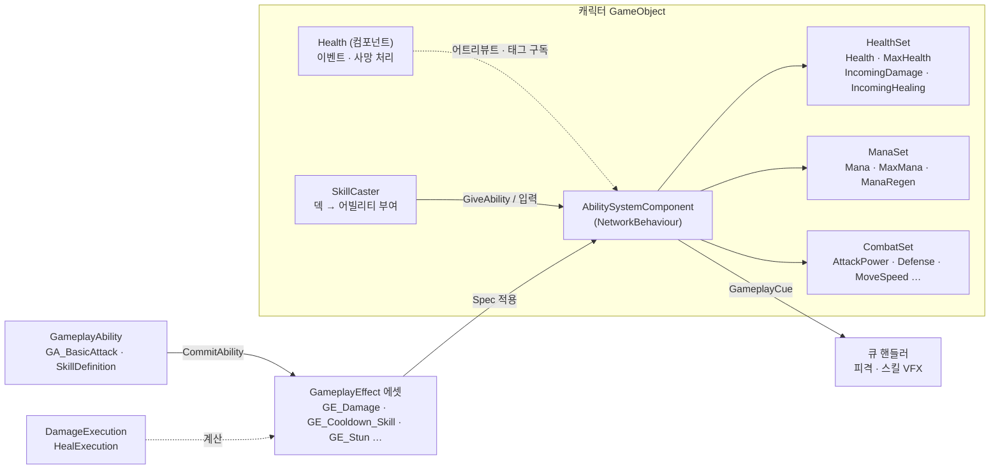
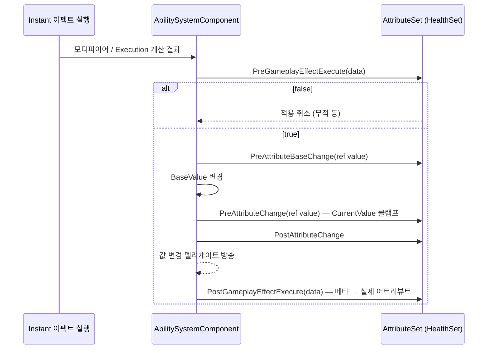
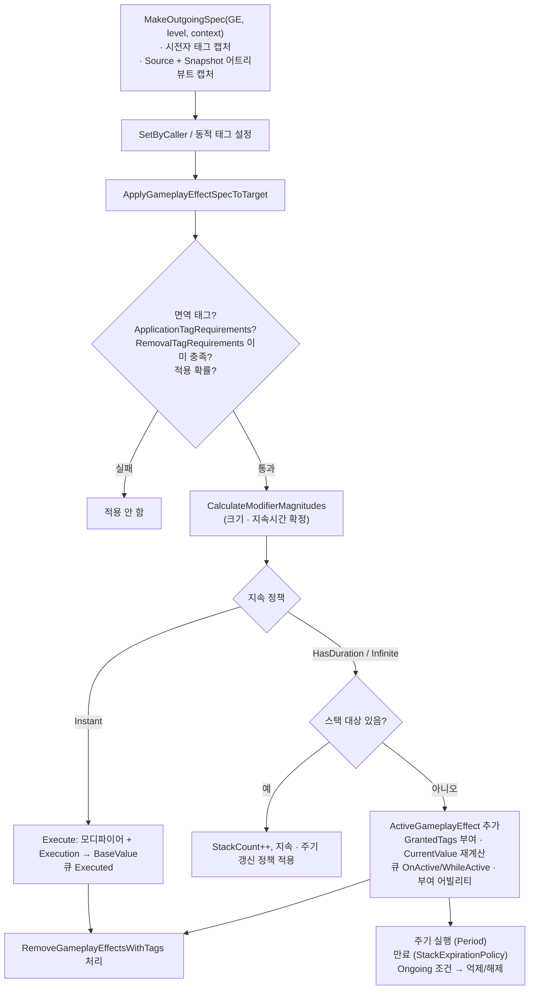
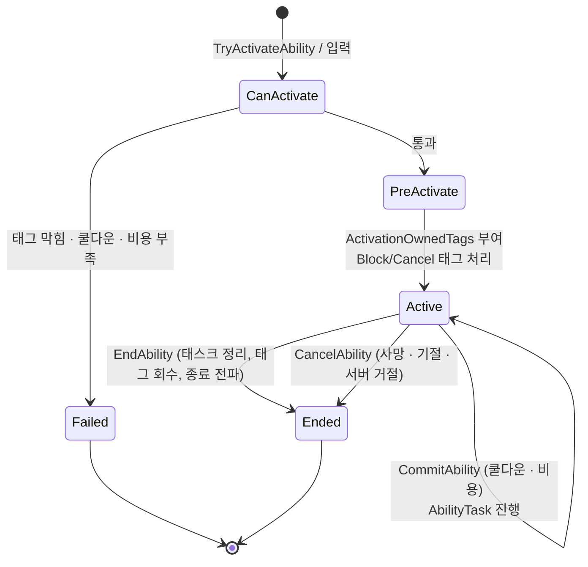
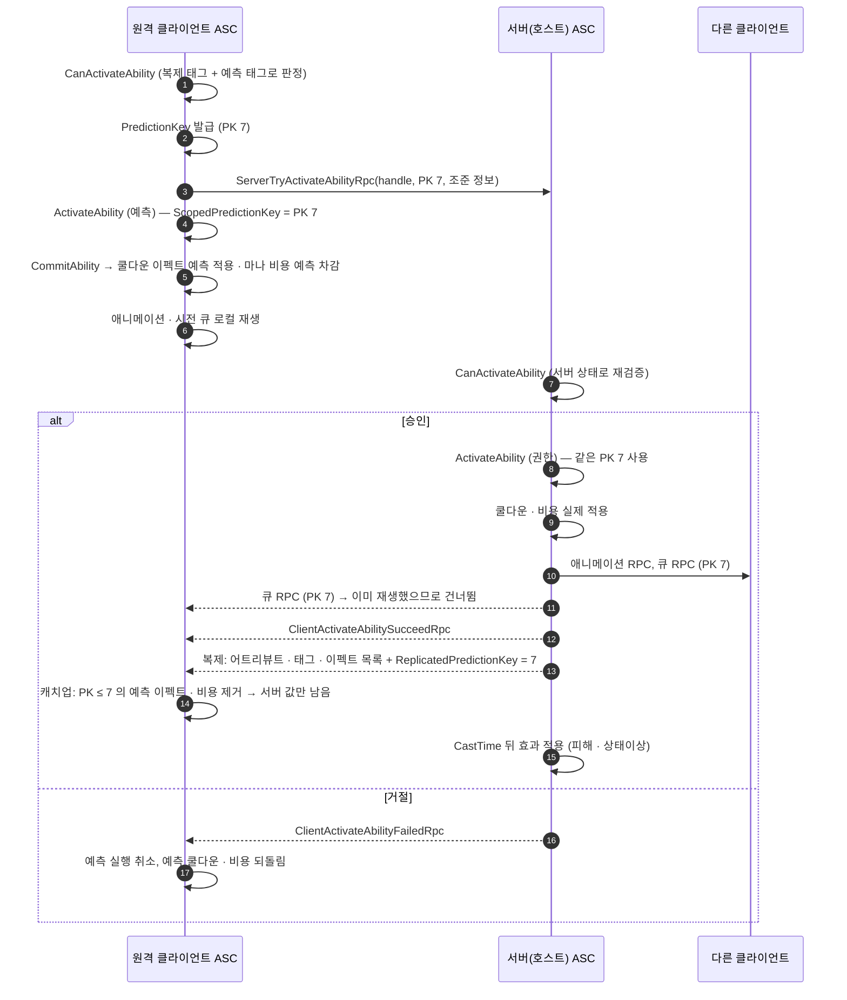

# Gameplay Ability System (GAS) — Unity · Netcode 구현

언리얼 엔진의 Gameplay Ability System 을 Unity + Netcode for GameObjects(NGO) 위에 옮긴 구현 설명서다.
체력 · 마나 · 전투 능력치 · 평타 · 스킬 · 상태이상이 모두 이 시스템을 거친다.
네트워크 모델은 **언리얼 리슨 서버**와 같다.

> 기준 시점: 2026-10-02. 명령줄 C# 빌드로 컴파일만 확인했고, Unity 플레이 모드에서는 아직 실행해 보지 않았다.

## 목차

1. [한눈에 보기](#1-한눈에-보기)
2. [언리얼 개념 ↔ 이 프로젝트 대응표](#2-언리얼-개념--이-프로젝트-대응표)
3. [파일 구성](#3-파일-구성)
4. [어트리뷰트](#4-어트리뷰트)
5. [게임플레이 이펙트](#5-게임플레이-이펙트)
6. [게임플레이 어빌리티](#6-게임플레이-어빌리티)
7. [게임플레이 태그](#7-게임플레이-태그)
8. [게임플레이 큐](#8-게임플레이-큐)
9. [리슨 서버 네트워크 모델](#9-리슨-서버-네트워크-모델)
10. [이 게임에서의 구성](#10-이-게임에서의-구성)
11. [확장 방법](#11-확장-방법)
12. [언리얼과 다른 점 · 한계](#12-언리얼과-다른-점--한계)

---

## 1. 한눈에 보기



- **어트리뷰트**(체력, 마나, 공격력 …)는 `AttributeSet` 이 가지고, ASC 가 관리한다.
- **이펙트**(피해, 쿨다운, 비용, 버프 …)는 어트리뷰트와 태그를 바꾸는 데이터 에셋이다.
- **어빌리티**(평타, 스킬)는 이펙트를 만들어 적용하는 행동이다.
- **태그**는 상태(기절, 사망, 쿨다운 중 …)를 표현하고, 어빌리티 발동 조건 · 이펙트 조건에 쓰인다.
- **큐**는 연출(피격, 스킬 VFX)을 네트워크로 전파한다.

---

## 2. 언리얼 개념 ↔ 이 프로젝트 대응표

| 언리얼 | 이 프로젝트 | 비고 |
|---|---|---|
| `UAbilitySystemComponent` | `AbilitySystemComponent` | NetworkBehaviour. 4개 partial 파일 |
| `UAttributeSet` | `AttributeSet` | 순수 C# 클래스. ASC 가 모든 피어에서 같은 순서로 생성 |
| `FGameplayAttributeData` | `GameplayAttributeData` | BaseValue / CurrentValue |
| `FGameplayAttribute` | `GameplayAttribute` | `"HealthSet.Health"` 형식 이름 |
| `PreAttributeChange` / `PostGameplayEffectExecute` 등 | 같은 이름의 가상 함수 | |
| `UGameplayEffect` | `GameplayEffect` (ScriptableObject) | 클래식(UE4 ~ 5.2) 필드 구성 |
| `FGameplayEffectSpec` / `Context` | `GameplayEffectSpec` / `GameplayEffectContext` | 스냅샷 캡처, SetByCaller, 동적 태그 |
| `FActiveGameplayEffect` / Handle | `ActiveGameplayEffect` / `ActiveGameplayEffectHandle` | |
| `FScalableFloat`, AttributeBased, SetByCaller, CustomCalculationClass | 같은 4가지 크기 계산 | `GameplayEffectModifierMagnitude` |
| `UGameplayModMagnitudeCalculation` (MMC) | `GameplayModMagnitudeCalculation` | 예: `CooldownMagnitudeCalculation` |
| `UGameplayEffectExecutionCalculation` | `GameplayEffectExecutionCalculation` | 예: `DamageExecution` |
| Stacking (BySource / ByTarget, 정책들) | 같은 옵션 | |
| Ongoing / Application / Removal Tag Requirements, Immunity | 같은 필드 | |
| `UGameplayAbility` | `GameplayAbility` (ScriptableObject) | 서브클래스 에셋 = 언리얼 블루프린트 어빌리티 |
| `FGameplayAbilitySpec` / Handle | `GameplayAbilitySpec` / `GameplayAbilitySpecHandle` | |
| Instancing Policy, Net Execution Policy | 같은 열거형 | |
| `CommitAbility`, `CheckCost`, `CheckCooldown`, `EndAbility`, `CancelAbility` | 같은 이름 | |
| `UAbilityTask` (WaitDelay, PlayMontageAndWait, WaitGameplayEvent …) | `AbilityTask_*` | ASC 가 틱을 돌린다 |
| `FPredictionKey`, `ScopedPredictionKey` | `PredictionKey`, `ScopedPredictionKey` | |
| `ServerTryActivateAbility` / `ClientActivateAbilitySucceed/Failed` | 같은 이름의 NGO RPC | |
| `ReplicatedPredictionKey` | `_replicatedPredictionKey` (NetworkVariable) | 예측 정리 시점 |
| `EGameplayEffectReplicationMode` | `GameplayEffectReplicationMode` | Minimal / Mixed / Full |
| `FGameplayTag`, `FGameplayTagContainer`, `FGameplayTagCountContainer` | 같은 이름 | 네트워크로는 32비트 해시 |
| `UGameplayCueManager`, `GameplayCueNotify_Static`, `IGameplayCueInterface` | 같은 이름 | |
| `UAbilitySystemGlobals` | `AbilitySystemGlobals` (Resources 에셋) | 에셋 ID 표 · 태그 목록 |
| 라이라 `ULyraAbilitySet`, `ULyraHealthSet`, `ULyraHealthComponent`, `ULyraGameData` | `AbilitySet`, `HealthSet`, `Health`, `ActionRPGGameData` | 구조를 그대로 따랐다 |

---

## 3. 파일 구성

### 3.1 프레임워크 (Foundation 패키지, 게임을 모름)

`Packages/com.actionrpg.foundation/Runtime/AbilitySystem/` · 네임스페이스 `ActionRPG.Core.AbilitySystem`

| 파일 | 내용 |
|---|---|
| `GameplayTags.cs` | GameplayTag, GameplayTagManager, GameplayTagContainer, GameplayTagRequirements, GameplayTagCountContainer |
| `Attributes.cs` | GameplayAttributeData, GameplayAttribute, AttributeSet, OnAttributeChangeData, 메타 어트리뷰트 표시 |
| `GameplayEffect.cs` | GameplayEffect 에셋, 모디파이어 · 크기 계산 · 스택 · 큐 정의, MMC / Execution 기반 클래스 |
| `GameplayEffectSpec.cs` | GameplayEffectSpec, GameplayEffectContext |
| `ActiveGameplayEffect.cs` | ActiveGameplayEffect, 핸들, PredictionKey, GameplayEffectQuery |
| `GameplayAbilityTypes.cs` | 정책 열거형, Spec · Handle · ActorInfo · ActivationInfo, TargetData, GameplayEventData |
| `GameplayAbility.cs` | GameplayAbility 기반 클래스, 프레임워크 기본 태그 |
| `AbilityTasks.cs` | WaitDelay, WaitGameplayEvent, WaitInputPress/Release, PlayMontageAndWait, WaitGameplayTag |
| `GameplayCues.cs` · `GameplayCueNotify*.cs` | 큐 파라미터, 큐 매니저, 큐 노티파이 |
| `AbilitySystemComponent*.cs` | ASC 본체 (수명주기 · 어트리뷰트 · 태그 / 이펙트 / 어빌리티 · RPC / 복제 · 큐 · 애니메이션) |
| `AbilitySystemGlobals.cs` · `AbilitySet.cs` | 전역 에셋 표, 헬퍼, 라이라식 AbilitySet |

에디터 도구: `Packages/com.actionrpg.foundation/Editor/AbilitySystem/AbilitySystemEditorTools.cs`
— 태그 · 어트리뷰트 · 세트 타입 드롭다운, ASC 런타임 디버그 인스펙터, `ActionRPG > Ability System > Globals 갱신` 메뉴.

### 3.2 게임 쪽 (Assets/Scripts)

| 파일 | 내용 |
|---|---|
| `Abilities/GameTags.cs` | 게임 네이티브 태그 (State.*, Cooldown.*, SetByCaller.*, Damage.Type.*, GameplayCue.*), 입력 슬롯 번호 |
| `Abilities/AttributeSets.cs` | HealthSet, ManaSet, CombatSet, AttributeInitializer(StatBlock → 어트리뷰트) |
| `Abilities/DamageExecution.cs` | 피해 공식 Execution |
| `Abilities/HealExecution.cs` | 회복 공식 Execution |
| `Abilities/CooldownMagnitudeCalculation.cs` | 쿨다운 길이 MMC (쿨다운 감소 / 공격 속도 반영) |
| `Abilities/ActionRPGGameData.cs` | 공용 이펙트 참조 모음 + `CombatSpecs` (피해 · 회복 스펙 헬퍼) |
| `Abilities/GA_BasicAttack.cs` | 평타 어빌리티 |
| `Skills/SkillDefinition.cs` | 스킬 = GameplayAbility 서브클래스 |
| `Skills/SkillCaster.cs` | 덱 → 어빌리티 부여, 입력 → ASC, UI 조회 |
| `Combat/Health.cs` | HealthSet ↔ 게임 이벤트 · 사망 처리 (라이라 HealthComponent) |

---

## 4. 어트리뷰트

### 4.1 값의 두 층

```
BaseValue    ← Instant / Periodic 이펙트, SetNumericAttributeBase 가 바꾼다 (영구)
CurrentValue ← BaseValue + 활성 지속형 이펙트 모디파이어 (일시)
             = ((Base + ΣAdd) × (1 + Σ(Mul−1))) ÷ (1 + Σ(Div−1)),  Override 가 있으면 마지막 Override
```

### 4.2 이 게임의 어트리뷰트 세트

| 세트 | 어트리뷰트 | 특이 사항 |
|---|---|---|
| `HealthSet` | Health, MaxHealth, **IncomingDamage**(메타), **IncomingHealing**(메타) | 피해는 메타 어트리뷰트로 들어와 `PostGameplayEffectExecute` 에서 Health 로 옮겨진다. 무적 · 사망이면 `PreGameplayEffectExecute` 가 막는다. MaxHealth 가 바뀌면 체력 비율 유지 |
| `ManaSet` | Mana, MaxMana, ManaRegen | Mana 는 [0, MaxMana] 로 자른다 |
| `CombatSet` | AttackPower, AbilityPower, Defense, MoveSpeed, AttackSpeed, CritChance, CritDamage, CooldownReduction | 기존 `StatBlock.Clamp` 와 같은 범위로 자른다 |

### 4.3 콜백 순서 (서버)



값을 구독할 때는 언리얼과 같은 방식을 쓴다.

```csharp
asc.GetGameplayAttributeValueChangeDelegate(ManaSet.ManaAttribute).OnValueChanged += data =>
    Debug.Log($"마나 {data.OldValue} → {data.NewValue}");
```

---

## 5. 게임플레이 이펙트

### 5.1 적용 파이프라인



### 5.2 크기(Magnitude) 계산 4종

| 종류 | 예 |
|---|---|
| ScalableFloat | `GE_Slow` 이동속도 × 0.6 |
| AttributeBased | `GE_ManaRegen`: 대상 ManaRegen × 0.25 (스냅샷 아님 → 주기마다 다시 읽음) |
| SetByCaller | `GE_Cost_Mana`: `SetByCaller.ManaCost` |
| CustomCalculationClass (MMC) | `GE_Cooldown_Skill` 지속시간: `MMC_Cooldown_Skill` |

### 5.3 Execution — 피해 공식

`GE_Damage` 는 모디파이어 없이 `EXEC_Damage`(DamageExecution) 하나만 가진다.

```
입력(SetByCaller) : Damage, AttackPowerScale, AbilityPowerScale, Knockback
캡처              : 공격자 AttackPower / AbilityPower / CritChance / CritDamage (스냅샷)
                    대상 Defense (적용 시점 값)
원 피해           = Damage + AttackPower × AttackPowerScale + AbilityPower × AbilityPowerScale
치명타            = Random < CritChance 이면 × CritDamage (컨텍스트에 IsCriticalHit 기록)
최종              = 원 피해 × 100 / (100 + Defense)   (Damage.Type.True 태그면 감쇠 없음)
출력              → IncomingDamage += 최종
```

발사체는 **발사 순간 스펙을 만들어** 화살에 실어 보낸다. 날아가는 동안 버프가 끝나도 발사 시점 공격력이 쓰인다(스냅샷).

---

## 6. 게임플레이 어빌리티

### 6.1 수명



### 6.2 이 게임의 어빌리티

| 어빌리티 | 정책 | 쿨다운 / 비용 | 막는 태그 |
|---|---|---|---|
| `GA_BasicAttack` | LocalPredicted, InstancedPerActor | `GE_Cooldown_BasicAttack` (무기별 SetByCaller ÷ 공격 속도) | State.Dead, State.Debuff.Stun, State.Debuff.Disarm |
| `SkillDefinition` (스킬 10종) | LocalPredicted, InstancedPerActor | `GE_Cooldown_Skill` + 동적 태그 `Cooldown.Skill.<Id>`, `GE_Cooldown_Global`, `GE_Cost_Mana` | State.Dead, State.Debuff.Stun, State.Debuff.Silence |

스킬 발동 순서: `CommitAbility` → 방향 전환 · 이동 잠금(조종 피어) → `PlayMontageAndWait`(애니메이션) → 시전 큐 → `WaitDelay(CastTime)` →
효과 조각별로 서버 `Execute`(이펙트 적용) / 조종 피어 `ExecuteLocal`(돌진) / 모든 피어 `GameplayCue.Skill.Effect`(VFX) → 종료.

---

## 7. 게임플레이 태그

| 태그 | 의미 | 주는 곳 |
|---|---|---|
| `State.Dead` | 사망 | `Health` (복제 루즈 태그) |
| `State.Invulnerable` | 무적 | `GE_Invulnerable` (돌진) |
| `State.Debuff.Stun` / `.Root` / `.Silence` / `.Disarm` | 행동 제한 | `GE_Stun` 등 |
| `State.Debuff.Slow` / `.Poison`, `State.Buff.Rally` | 상태 표시 | `GE_Slow` · `GE_Poison` · `GE_Rally` |
| `State.Casting` / `State.Attacking` | 시전 · 공격 중 | 어빌리티 ActivationOwnedTags |
| `Cooldown.Global` / `Cooldown.BasicAttack` / `Cooldown.Skill.<Id>` | 쿨다운 | 쿨다운 이펙트 |
| `SetByCaller.*` | 스펙 데이터 키 | 코드가 스펙에 넣는다 |
| `Damage.Type.Physical/Magical/True` | 피해 속성 | 피해 스펙 동적 AssetTag |
| `GameplayCue.Character.Hit` / `.Skill.Cast` / `.Skill.Effect` | 연출 | 큐 |

태그는 계층형이다. `HasMatchingGameplayTag(State.Debuff)` 는 `State.Debuff.Stun` 을 가진 캐릭터에서도 true 다.
네트워크로는 이름 대신 FNV-1a 32비트 해시가 오간다. 계층 판정을 하려면 클라이언트도 태그 이름을 알아야 하므로
`AbilitySystemGlobals.GameplayTagList` 에 등록해 둔다(Globals 갱신 메뉴가 자동으로 채운다).

---

## 8. 게임플레이 큐

| 큐 | 실행 | 처리 |
|---|---|---|
| `GameplayCue.Character.Hit` | 서버가 피해를 반영한 직후 | `Health`(IGameplayCueInterface) → `Damaged` 이벤트 · 피해 숫자 · 피격 애니메이션 |
| `GameplayCue.Skill.Cast` | 스킬 발동 | `SkillDefinition.CastVfxPrefab` / `CastSfx` 재생 |
| `GameplayCue.Skill.Effect` | 스킬 효과 조각 실행 | 해당 `SkillEffect.ExecuteVisual` (화살비 착탄 VFX 등) |
| 이펙트 `GameplayCues` 필드 | 이펙트 실행 · 추가 · 제거 | `GameplayCueNotify` 에셋 또는 코드 핸들러 |

- Executed 는 서버가 `NetMulticastInvokeGameplayCueExecutedRpc` 로 보낸다. 예측으로 이미 재생한 소유 클라이언트는 같은 예측 키를 보고 건너뛴다.
- WhileActive(지속형) 큐는 복제 목록으로 관리하므로 늦게 들어온 클라이언트도 받는다.

---

## 9. 리슨 서버 네트워크 모델

### 9.1 누가 무엇을 결정하는가

| 대상 | 결정 | 설명 |
|---|---|---|
| 어트리뷰트 · 이펙트 · 태그(이펙트/복제 루즈) | 서버 | 클라이언트는 받기만 한다 (예측분 제외) |
| 어빌리티 부여 (GiveAbility) | 서버 | 소유 클라이언트에게만 복제 |
| 호스트 자신의 어빌리티 | 호스트(=서버) | 권한을 가진 채 바로 실행. 예측 · RPC 없음 |
| 원격 클라이언트의 LocalPredicted 어빌리티 | 클라이언트가 먼저 실행 → 서버가 검증 | 거절되면 되돌림 |
| AI 어빌리티 · 공격 | 서버 | 서버가 소유 |

### 9.2 원격 클라이언트의 스킬 발동 (예측)



### 9.3 호스트의 스킬 발동

호스트는 서버이므로 `IsAuthority == true`. `AbilityLocalInputPressed` → `InternalTryActivateAbility` 가 권한 모드로 바로 실행하고,
이펙트 · 태그 변경은 다음 `LateUpdate` 에서 원격 클라이언트에 복제된다. 애니메이션 · 큐는 RPC(`SendTo.NotServer`)로 다른 피어에 전파된다.

### 9.4 복제 목록

| 목록 | 타입 | 읽을 수 있는 쪽 | 내용 |
|---|---|---|---|
| `_repAttributes` | NetworkList&lt;AttributeRepData&gt; | 모두 | 메타가 아닌 어트리뷰트의 Base · Current |
| `_repTags` | NetworkList&lt;TagCountRepData&gt; | 모두 | 이펙트가 준 태그 + 복제 루즈 태그(사망) |
| `_repEffects` | NetworkList&lt;ActiveEffectRepData&gt; | Mixed: 소유자 / Full: 모두 / Minimal: 없음 | 활성 이펙트 요약 (UI 쿨다운 · 버프 표시용) |
| `_repAbilities` | NetworkList&lt;AbilitySpecRepData&gt; | 소유자 | 부여된 어빌리티 |
| `_repCues` | NetworkList&lt;ActiveCueRepData&gt; | 모두 | 지속형 큐 |
| `_replicatedPredictionKey` | NetworkVariable&lt;int&gt; | 소유자 | 서버가 처리한 마지막 예측 키 |

플레이어 ASC 는 **Mixed**, 적 ASC 는 **Minimal** (언리얼 권장값). 서버는 바뀐 것만 `LateUpdate` 에 모아서 보낸다.

### 9.5 RPC

| RPC | 방향 | 언리얼 대응 |
|---|---|---|
| `ServerTryActivateAbilityRpc` | 소유자 → 서버 | ServerTryActivateAbility(WithEventData) |
| `ClientActivateAbilitySucceedRpc` / `FailedRpc` | 서버 → 소유자 | ClientActivateAbilitySucceed / Failed |
| `ClientTryActivateAbilityRpc` | 서버 → 소유자 | ClientTryActivateAbility (ServerInitiated) |
| `ServerEndAbilityRpc` / `ClientEndAbilityRpc` | 양방향 | Server/ClientEndAbility, Cancel |
| `ServerSetInputPressedRpc` / `ReleasedRpc` | 소유자 → 서버 | ServerSetInputPressed/Released |
| `NetMulticastInvokeGameplayCueExecutedRpc` | 서버 → 다른 피어 | NetMulticast_InvokeGameplayCueExecuted |
| `PlayAbilityAnimationRpc` | 서버 → 다른 피어 | RepAnimMontageInfo |

---

## 10. 이 게임에서의 구성

`ActionRPG > 샘플 콘텐츠 생성` 이 아래 에셋을 만든다.

| 에셋 | 위치 | 설명 |
|---|---|---|
| `EXEC_Damage`, `EXEC_Heal` | Data/Abilities/Calculations | 피해 · 회복 Execution |
| `MMC_Cooldown_Skill`, `MMC_Cooldown_BasicAttack` | 〃 | 쿨다운 길이 MMC |
| `GE_Damage`, `GE_Heal` | Data/Abilities/Effects | Instant, Execution 사용 |
| `GE_Cost_Mana` | 〃 | Instant, Mana += SetByCaller.ManaCost |
| `GE_Cooldown_Skill`, `GE_Cooldown_Global`, `GE_Cooldown_BasicAttack` | 〃 | HasDuration, 쿨다운 태그 부여 |
| `GE_Invulnerable` | 〃 | HasDuration(SetByCaller.Duration), State.Invulnerable |
| `GE_ManaRegen` | 〃 | Infinite, 0.25초 주기, ManaRegen 기반 |
| `GE_InitStats_Player` | 〃 | Instant, Override 로 플레이어 기본 능력치 설정 |
| `GE_Stun`, `GE_Poison`, `GE_Slow`, `GE_Rally` | 〃 | 상태이상 (기존 SE_* 를 대체) |
| `GA_BasicAttack` | Data/Abilities | 평타 |
| `AS_Player` | 〃 | Health/Mana/CombatSet + GA_BasicAttack(입력 10) + GE_InitStats_Player + GE_ManaRegen |
| `AS_Enemy` | 〃 | Health/CombatSet (능력치는 EnemyDefinition.Stats 로 초기화) |
| `ActionRPGGameData` | Resources | 공용 이펙트 참조 |
| `AbilitySystemGlobals` | Resources | 이펙트 · 어빌리티 · 큐 ID 표, 태그 목록 |

플레이어 프리팹: `AbilitySystemComponent(AS_Player, Mixed)` → `Health` → … → `SkillCaster` → `PlayerController`.
적 프리팹: `AbilitySystemComponent(AS_Enemy, Minimal)` → `Health` → `EnemyBrain`.

**적용 순서 (처음 한 번):**
1. `ActionRPG > 샘플 콘텐츠 생성` — GAS 에셋 · 스킬 · 적 정의를 만들고 Globals 를 갱신한다.
2. `ActionRPG > 샘플 프리팹 생성` — ASC 가 붙은 프리팹으로 다시 만든다.
3. `ActionRPG > 샘플 씬 생성` — 씬을 다시 만든다 (씬 배치 NetworkObject 해시도 새로 생성).

---

## 11. 확장 방법

### 11.1 새 어트리뷰트

```csharp
public sealed class CombatSet : AttributeSet
{
    public readonly GameplayAttributeData Tenacity = new GameplayAttributeData(0f);
    public static readonly GameplayAttribute TenacityAttribute = GameplayAttribute.Of<CombatSet>(nameof(Tenacity));
}
```
필드를 추가하면 복제 인덱스가 바뀌므로 호스트 · 클라이언트를 같은 빌드로 맞춘다.

### 11.2 새 버프 / 디버프

`Create > ActionRPG > Ability System > Gameplay Effect` 로 만들고 Duration · Modifiers · GrantedTags 를 채운다.
스킬에서 쓰려면 `ApplyStatusEffect`, `ArcDamageEffect.ApplyStatus` 등에 꽂는다. 만든 뒤 **Globals 갱신 메뉴를 실행**한다.

### 11.3 새 어빌리티

```csharp
[CreateAssetMenu(menuName = "ActionRPG/Abilities/GA_Taunt")]
public class GA_Taunt : GameplayAbility
{
    protected override void ActivateAbility(GameplayAbilitySpecHandle handle, GameplayAbilityActorInfo actorInfo,
        GameplayAbilityActivationInfo activationInfo, GameplayEventData? triggerEventData)
    {
        if (!CommitAbility(handle, actorInfo, activationInfo)) { EndAbility(handle, actorInfo, activationInfo, true, true); return; }

        var wait = AbilityTask_WaitDelay.WaitDelay(this, 0.3f);
        wait.OnFinish += () =>
        {
            if (HasAuthority()) { /* 서버: 주변 적 EnemyBrain.Taunt(...) */ }
            K2_EndAbility();
        };
        wait.ReadyForActivation();
    }
}
```
`AbilitySet` 의 GrantedGameplayAbilities 에 넣거나 서버에서 `asc.GiveAbility(new GameplayAbilitySpec(asset, 1, inputId))` 로 준다.

### 11.4 새 큐

- 에셋: `Create > ActionRPG > Ability System > Gameplay Cue (Spawn Prefab)` 의 GameplayCueTag 를 정하고 Globals 갱신.
- 코드: `GameplayCueManager.RegisterHandler(tag, handler)` 또는 캐릭터 컴포넌트에 `IGameplayCueInterface` 구현.

### 11.5 디버그

플레이 중 캐릭터를 선택하면 `AbilitySystemComponent` 인스펙터에 어트리뷰트 · 소유 태그 · 활성 이펙트 · 어빌리티가 실시간으로 표시된다
(언리얼 `showdebug abilitysystem`). 코드에서는 `asc.GetDebugString()`.

---

## 12. 언리얼과 다른 점 · 한계

언리얼 GAS 의 구조 · 이름 · 흐름을 따랐지만 엔진 차이로 아래는 다르게 구현했거나 범위에서 뺐다.

| 항목 | 이 구현 |
|---|---|
| 예측 범위 | 어빌리티 발동, 자기 자신에 대한 지속형 이펙트(쿨다운), Instant Additive 모디파이어(비용), 발동 프레임의 큐를 예측한다. 남에게 주는 효과는 예측하지 않는다(언리얼과 같음). 발동 후 태스크에서 새 예측 키를 만드는 "종속 예측 키"는 없다 — 시전 시간 뒤 효과는 서버 결과를 기다리고, 연출만 로컬에서 먼저 재생한다 |
| 조준 데이터 | 언리얼의 WaitTargetData + ServerSetReplicatedTargetData 대신, 발동 RPC 의 이벤트 데이터에 조준 정보를 실어 보낸다(ServerTryActivateAbilityWithEventData 방식) |
| 어트리뷰트 복제 | 어트리뷰트마다 RepNotify 함수를 두는 대신 한 개의 NetworkList 로 보내고, 클라이언트에서 같은 값 변경 델리게이트를 쏜다 |
| 클라이언트 CurrentValue | 서버가 보낸 CurrentValue 에 예측분만 얹는다. 클라이언트가 복제 이펙트로 집계를 다시 하지 않는다 |
| 지속형 이펙트의 비스냅샷 캡처 | 주기 실행은 매번 다시 계산한다. 지속형 모디파이어는 적용 시점 값으로 고정되며, 캡처한 어트리뷰트가 바뀌어도 자동 재계산하지 않는다 |
| GameplayEffect 구성 | UE 5.3+ 의 GameplayEffectComponent 방식이 아니라 클래식 필드 방식. 스택 오버플로 이펙트, GameplayTagQuery 는 없다 |
| 몽타주 | Unity Animator 트리거 + 길이를 호출자가 넘긴다. 몽타주 섹션 점프 · 예측 롤백은 없다 |
| 어빌리티 인스턴스 복제 | 언리얼의 ReplicationPolicy(어빌리티 객체 복제)는 없다. 어빌리티 간 상태 공유는 이펙트 · 태그로 한다 |
| 에셋 식별 | 언리얼의 NetGUID 대신 "타입이름:에셋이름" 해시. 같은 타입의 에셋 이름이 겹치면 안 된다 |
| 검증 | 명령줄 빌드로 컴파일만 확인했다. Unity 플레이 모드 · 멀티플레이 실행 확인이 필요하다 |
