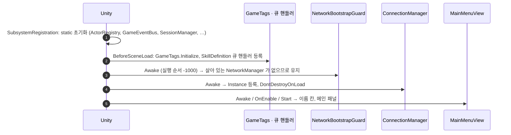
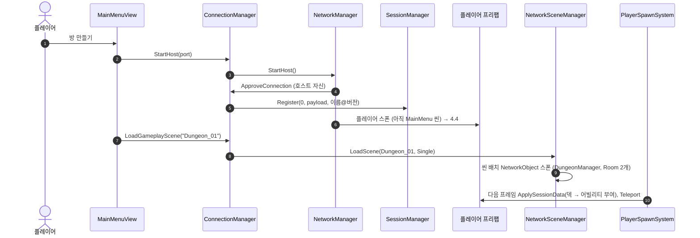
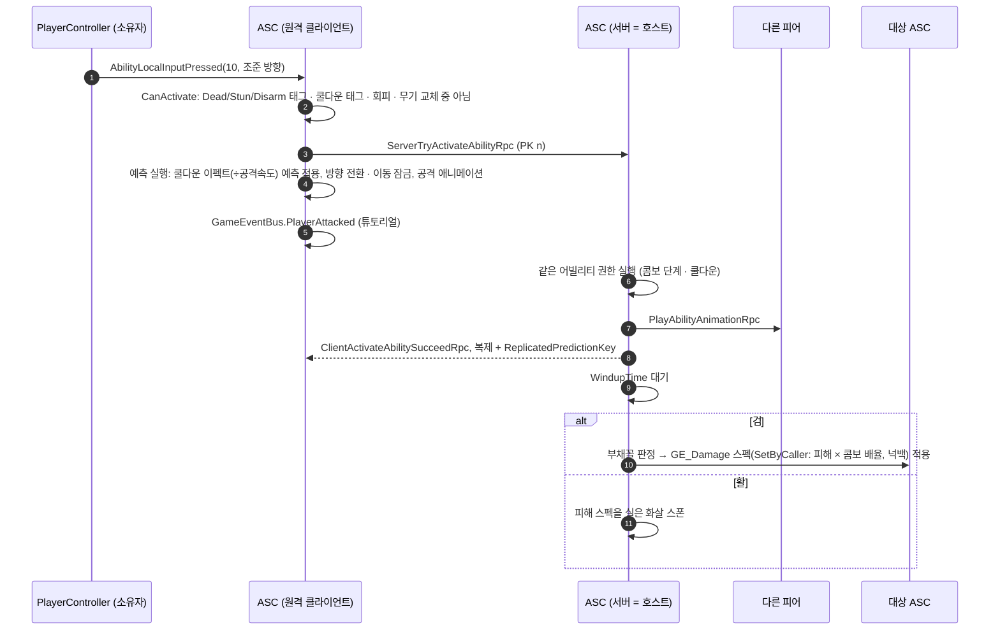
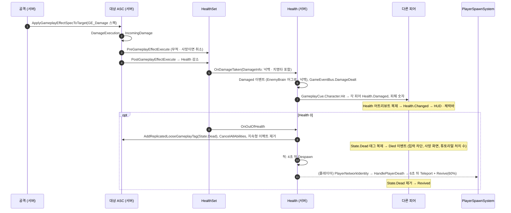
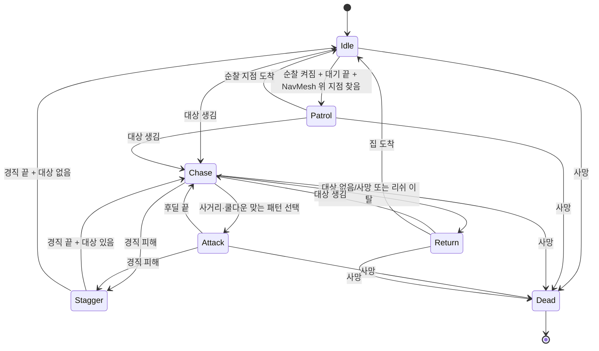
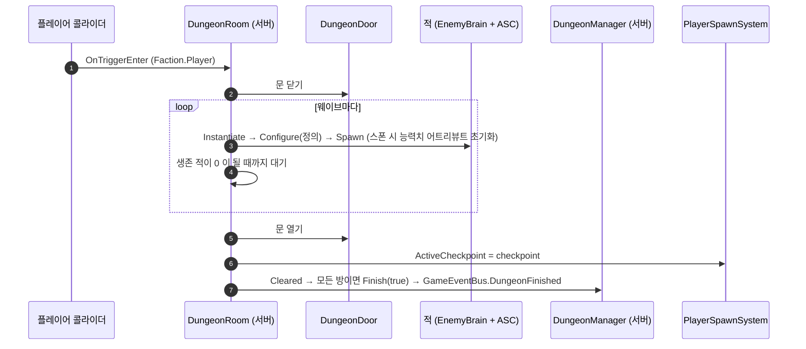
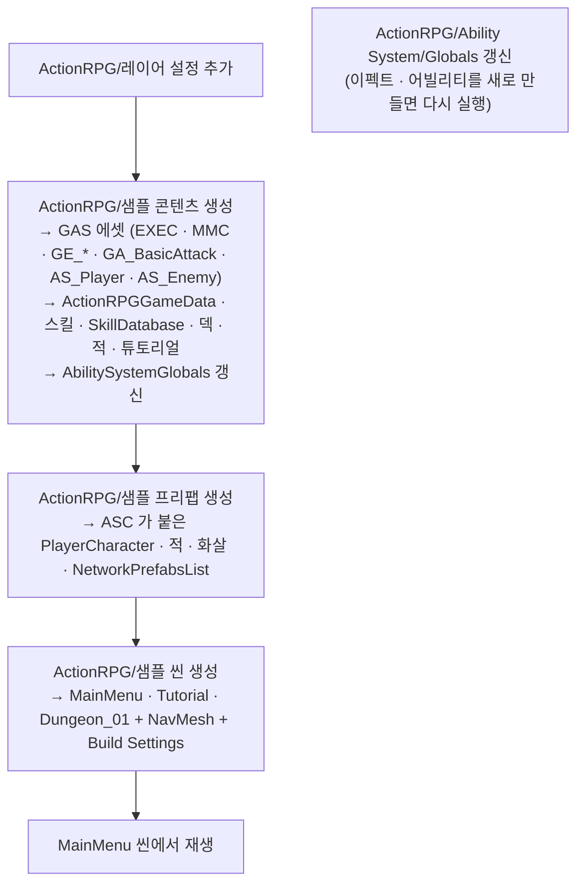

# ActionRPGProject — 클래스 역할과 동작 흐름

이 문서는 "어떤 클래스가 무슨 일을 하고, 게임이 돌아갈 때 어떤 순서로 서로를 부르는가"를 설명한다.
클래스의 필드·메서드 목록과 정적 관계는 [UML.md](UML.md), 능력치 · 스킬 시스템(GAS)의 상세는 [AbilitySystem.md](AbilitySystem.md) 에 있다.

> 기준 시점: 2026-10-02 (GAS 도입 이후). 코드를 직접 읽고 정리했다.
> 실행해서 확인한 내용은 따로 "확인됨"이라고 적었고, 나머지는 코드를 읽고 추론한 동작이다.

## 목차

1. [큰 그림](#1-큰-그림)
2. [씬 구성](#2-씬-구성)
3. [클래스별 역할](#3-클래스별-역할)
4. [동작 흐름](#4-동작-흐름)
5. [GameEventBus 발행 · 구독 표](#5-gameeventbus-발행--구독-표)
6. [네트워크 동기화 목록](#6-네트워크-동기화-목록)
7. [에디터 파이프라인](#7-에디터-파이프라인)
8. [정리할 때 참고할 점](#8-정리할-때-참고할-점)

---

## 1. 큰 그림

### 1.1 어셈블리 3층 구조

| 어셈블리 | 위치 | 성격 | 참조하는 쪽 |
|---|---|---|---|
| `ActionRPG.Foundation` | `Packages/com.actionrpg.foundation/Runtime` | 게임 규칙을 모르는 기반 코드. **GAS 프레임워크**, 기초 타입, 이벤트 버스, 액터 레지스트리, 세이브, 직렬화, 에셋 로딩, 라이프사이클 추적 | Runtime, Editor, Foundation.Editor |
| `ActionRPG.Foundation.Editor` | `Packages/com.actionrpg.foundation/Editor` | CSV 임포터, Lifecycle Tracker 창, GAS 에디터 도구(드롭다운 · ASC 디버그 인스펙터 · Globals 갱신) | Editor |
| `ActionRPG.Runtime` | `Assets/Scripts` | 실제 게임플레이. GAS 게임 쪽(어트리뷰트 세트 · 피해 공식 · 어빌리티), 캐릭터, 전투, 스킬, AI, 던전, 튜토리얼, 네트워크, UI | Editor |
| `ActionRPG.Editor` | `Assets/Editor` | 샘플 콘텐츠·프리팹·씬을 자동으로 만드는 메뉴 도구 | 없음 |

의존 방향은 항상 **Editor → Runtime → Foundation** 한 방향이다. Foundation 은 Runtime 의 타입을 하나도 모른다.
그래서 Foundation 의 `IDamageable`, `IInteractable`, `ITrackable`, `IAbilityAnimationDriver`, `IGameplayCueInterface` 같은 인터페이스를 Runtime 이 구현하는 방식으로 연결된다.

### 1.2 권한 모델 — 누가 무엇을 결정하는가 (리슨 서버)

4인 협동 게임이고, 방을 만든 플레이어가 **호스트(=서버 + 클라이언트)** 인 리슨 서버 구조다.

| 대상 | 결정하는 쪽 | 구현 |
|---|---|---|
| 플레이어 이동 · 회전 · 점프 · 회피 · 대시 | **소유 클라이언트** | `ClientNetworkTransform`. 서버가 위치를 바꿔야 하면 `PlayerNetworkIdentity.TeleportRpc` 로 소유자에게 부탁한다 |
| 적 이동 · AI 판단 | **서버** | `EnemyBrain` 은 서버에서만 켜지고, 위치는 서버 권한 `NetworkTransform` 으로 복제 |
| 체력 · 마나 · 능력치 · 상태이상 | **서버** | GAS 어트리뷰트 · 게임플레이 이펙트. 클라이언트는 복제 값을 받는다 |
| 평타 · 스킬 발동 | 호스트: **바로 권한 실행** / 원격 클라이언트: **예측 실행 → 서버 검증** | `AbilitySystemComponent`. 서버가 거절하면 예측 쿨다운 · 비용을 되돌린다 |
| 피해 · 회복 판정 | **서버** | 어빌리티의 서버 인스턴스만 이펙트를 남에게 적용한다 |
| 무기 교체 | **서버** | 소유자 요청 → 서버가 `_current` 변경 |
| 던전 진행 · 적 소환 | **서버** | `DungeonManager`, `DungeonRoom` |
| 애니메이션 · VFX · 피해 숫자 | **모든 피어가 각자** | 어빌리티 애니메이션은 ASC RPC, 피격 · 스킬 VFX 는 게임플레이 큐로 신호만 받아 로컬 재생 |
| HUD · 메뉴 | **로컬** | C# 이벤트, ASC 어트리뷰트 델리게이트, `GameEventBus` 만 구독 |

### 1.3 클래스끼리 소식을 전하는 방법

| 방법 | 언제 쓰나 | 예 |
|---|---|---|
| **NetworkVariable / NetworkList** | 지속되는 상태. 늦게 들어온 클라이언트도 현재 값을 받아야 할 때 | ASC 어트리뷰트 · 태그 · 이펙트 목록, `WeaponController._current`, `DungeonManager._state` |
| **RPC** | 한 번 일어나는 일. 요청, 응답, 연출 신호 | `ServerTryActivateAbilityRpc`, `ClientActivateAbilityFailedRpc`, `PlayAbilityAnimationRpc` |
| **게임플레이 큐** | 연출 전파. 예측 재생과 서버 전파가 겹치지 않게 예측 키로 걸러진다 | `GameplayCue.Character.Hit`, `GameplayCue.Skill.Effect` |
| **C# event / GameEventBus** | 같은 피어 안에서 UI · 튜토리얼에 알릴 때 | `Health.Changed` → HUD, `GameEventBus.PlayerJumped` → 튜토리얼 스텝 |

한 변화가 여러 단계를 거친다. 예를 들어 서버에서 피해 이펙트가 적용되면
`HealthSet.Health` 가 바뀌고 → `_repAttributes` 로 복제 → 각 피어의 ASC 가 값 변경 델리게이트를 쏘고 → `Health.Changed` → HUD 가 바를 줄인다.

### 1.4 전역 진입점 (static / 싱글턴)

| 이름 | 종류 | 수명 | 쓰는 곳 |
|---|---|---|---|
| `ActorRegistry` | static | 앱 전체 | 적 탐지, 단일 대상 스킬, 전멸 판정, HUD · 튜토리얼의 로컬 플레이어 찾기 |
| `GameEventBus` | static | 앱 전체 | 피해 숫자, HUD 목표·대사, 튜토리얼 조건 |
| `AbilitySystemGlobals` | ScriptableObject 싱글턴 (`Resources/AbilitySystemGlobals`) | 앱 전체 | 이펙트 · 어빌리티 에셋 ID 표, 태그 목록, 큐 노티파이 등록 |
| `GameplayTagManager` | static | 앱 전체 | 태그 이름 ↔ 해시, 부모 태그 |
| `GameplayCueManager` | static | 앱 전체 | 큐 태그 → 핸들러 |
| `ActionRPGGameData` | ScriptableObject 싱글턴 (`Resources/ActionRPGGameData`) | 앱 전체 | 공용 피해 · 회복 · 비용 · 쿨다운 · 무적 이펙트 |
| `SessionManager` | static | 앱 전체 (서버에서만 의미) | 접속 승인, 스폰 시 이름·덱 적용 |
| `SkillDatabase.Instance` | ScriptableObject 싱글턴 (`Resources/SkillDatabase`) | 앱 전체 | 덱 검증, 슬롯 해석, 덱 편집 화면 |
| `LoadoutStorage` | static (PlayerPrefs) | 앱 전체 | 메뉴 이름·덱, 접속 페이로드 |
| `SaveManager` / `CatalogService` | static (서비스 교체 가능) | 앱 전체 | 프로필 저장 / 에셋 로딩 |
| `ConnectionManager.Instance` | MonoBehaviour 싱글턴, DontDestroyOnLoad | 첫 생성 후 계속 | 메뉴의 호스트·참가, 던전 종료 |
| `PlayerSpawnSystem.Instance` | MonoBehaviour 싱글턴 | 씬 단위 | 스폰 위치, 부활, 체크포인트 |
| `DungeonManager.Instance` | NetworkBehaviour 싱글턴 | 씬 단위 | (현재 외부 사용처 없음) |
| `PlayerCameraRig.Instance` | MonoBehaviour 싱글턴 | 씬 단위 | 플레이어 카메라, 피해 숫자·체력바 빌보드, 튜토리얼 시야 스텝 |
| `PlayerNetworkIdentity.All` | static List | 스폰된 동안 | 파티 프레임, 던전 재시작 |

---

## 2. 씬 구성

`ActionRPG > 샘플 씬 생성` 메뉴(`SampleSceneGenerator`)가 만드는 세 씬의 구성이다.

| 씬 | 주요 오브젝트 | 비고 |
|---|---|---|
| `MainMenu` | Camera, EventSystem, **NetworkBootstrap**(`NetworkManager` + `UnityTransport` + `ConnectionManager` + `NetworkBootstrapGuard`, 자동 호스트 끔), Canvas(`MainMenuView`, `DeckBuilderView`) | 게임의 시작점. 여기서 만든 `NetworkManager`/`ConnectionManager` 가 이후 씬까지 살아남는다 |
| `Tutorial` | Camera(+`PlayerCameraRig`), EventSystem, NetworkBootstrap(자동 호스트 끔), HUD Canvas(`HUDController`, `DamageNumberSpawner`), 바닥(+`NavMeshSurface`), `TutorialDirector`, `Marker_Exit`, `PlayerSpawnSystem` | 호스트는 `TutorialDirector` 가 직접 시작한다 |
| `Dungeon_01` | Camera(+`PlayerCameraRig`), EventSystem, NetworkBootstrap(**자동 호스트 켬**), HUD Canvas, `PlayerSpawnSystem`, **`DungeonManager`**(NetworkObject), **`Room_01_Entrance` · `Room_02_Boss`**(NetworkObject + `DungeonRoom` + 트리거), 바닥(+`NavMeshSurface`) | 씬에 미리 놓인 NetworkObject 3개의 `GlobalObjectIdHash` 는 생성기가 저장 → 다시 열기 → 저장으로 만든다 |

모든 씬에 NetworkBootstrap 이 있는 이유는 **각 씬을 단독으로 재생해도 동작하게** 하기 위해서다.
메뉴를 거쳐 들어오면 이미 살아 있는 `NetworkManager` 가 있으므로 `NetworkBootstrapGuard` 가 새 씬의 것을 스스로 지운다.

---

## 3. 클래스별 역할

### 3.1 Foundation — Core (`ActionRPG.Core`)

| 클래스 | 역할 | 주로 쓰는 곳 |
|---|---|---|
| `IDamageable` | "맞을 수 있는 것"의 계약. 생존 여부, 진영, 피해·회복 적용 | 구현: `Health`. 사용: 범위 판정 · AI · 레지스트리 |
| `IInteractable` | "G 키로 상호작용할 수 있는 것"의 계약 | 구현: `DungeonDoor`. 사용: `PlayerInteractor` |
| `DamageInfo` | 한 번의 타격 정보(양, 종류, 진영, 맞은 지점, 넉백, 치명타) | `HealthSet` 이 만들고 `Health.Damaged` · `GameEventBus` 로 전달 |
| `StatBlock` | 캐릭터 스탯 11종 묶음 | `EnemyDefinition` 의 기본 능력치. `AttributeInitializer` 가 어트리뷰트로 옮긴다 |
| `StatModifier` | 스탯 보정 구조체 | (GAS 도입 후 사용처 없음) |
| `DamageType` · `Faction` · `WeaponType` · `StatType` · `ModifierOp` | 열거형 | 전역 |
| `FactionExtensions` | 진영 간 적대·우호 판정 | `CombatQuery`, `ActorRegistry`, `Projectile` |
| `ActorRegistry` | 살아 있는 `IDamageable` 목록과 **로컬 플레이어** 보관 | `Health` 가 등록, AI · 스킬 · 던전 · HUD · 튜토리얼이 조회 |
| `GameEventBus` | 전역 static 이벤트 14종 | [5장 표](#5-gameeventbus-발행--구독-표) |
| `GameConstants` | 최대 인원(4), 슬롯 수(4), GCD(0.3초), 포트, 씬 이름, 레이어, 애니메이터 파라미터 해시 | 전역 |

### 3.2 Foundation — GAS 프레임워크 (`ActionRPG.Core.AbilitySystem`)

| 클래스 | 역할 |
|---|---|
| `AbilitySystemComponent` | 캐릭터 하나의 능력치 · 이펙트 · 태그 · 어빌리티를 관리하는 NetworkBehaviour. 리슨 서버 예측 · 복제 · RPC 를 모두 담당 |
| `AttributeSet` · `GameplayAttributeData` · `GameplayAttribute` | 어트리뷰트 묶음과 값(Base/Current), 어트리뷰트 식별자. Pre/Post 콜백 |
| `GameplayEffect` | 어트리뷰트 · 태그 · 큐 · 어빌리티를 바꾸는 데이터 에셋 (Instant / HasDuration / Infinite, 주기, 스택, 태그 조건) |
| `GameplayEffectSpec` · `GameplayEffectContext` | 한 번의 적용 계획(레벨, SetByCaller, 스냅샷, 동적 태그)과 출처 정보 |
| `ActiveGameplayEffect` · `GameplayEffectQuery` | 활성 이펙트와 그것을 고르는 조건 |
| `GameplayModMagnitudeCalculation` · `GameplayEffectExecutionCalculation` | 크기 계산(MMC) · 복합 계산(Execution) 기반 클래스 |
| `GameplayAbility` | 행동 하나. 발동 조건 · 커밋 · 종료 · 취소, 정책(Instancing / NetExecution) |
| `AbilityTask_*` | 어빌리티 안의 비동기 작업 (WaitDelay, PlayMontageAndWait, WaitGameplayEvent, WaitInputPress/Release, WaitGameplayTag) |
| `GameplayTag` · `GameplayTagContainer` · `GameplayTagCountContainer` · `GameplayTagRequirements` | 계층형 태그와 개수 집계 |
| `GameplayCueManager` · `GameplayCueNotify` · `IGameplayCueInterface` · `GameplayCueParameters` | 연출 전파 |
| `AbilitySystemGlobals` · `AbilitySystemStatics` · `AbilitySet` | 전역 에셋 표 · 헬퍼 · 라이라식 구성 묶음 |
| `PredictionKey` | 예측 실행을 서버 결과와 짝 맞추는 번호 |

### 3.3 Foundation — 인프라

| 클래스 | 역할 |
|---|---|
| `ISaveService` · `SaveManager` · `LocalFileSaveService` · `CompositeSaveService` · `CloudSaveServiceStub` | 저장소 추상화와 구현 (로컬 파일 · 폴백 · 클라우드 자리 표시자) |
| `IBinarySerializer` · `ProtoBinarySerializer` · `SaveEnvelope<T>` | protobuf-net 직렬화와 저장 파일 겉봉투 |
| `IAssetCatalog` · `AddressableAssetCatalog` · `CatalogService` · `AssetHandle<T>` | Addressables 로딩 추상화 |
| `LifecycleTracker` · `LifecycleHandle` · `LifecycleRecord` · `ITrackable` | 생성·해제 기록 (에디터 · 개발 빌드) |
| `CsvParser` · `CsvColumnAttribute` · `CsvPrimaryKeyAttribute` | CSV 데이터 드리븐 |

### 3.4 Foundation — Editor

| 클래스 | 역할 |
|---|---|
| `CsvImportProfile` · `CsvScriptableObjectImporter` | CSV → ScriptableObject 임포트 |
| `LifecycleTrackerWindow` | `LifecycleTracker` 기록 창 |
| `AbilitySystemGlobalsBuilder` | `ActionRPG > Ability System > Globals 갱신` — 프로젝트의 이펙트 · 어빌리티 · 큐 · 태그를 Globals 에 등록 |
| `GameplayTagDrawer` · `GameplayAttributeDrawer` · `AttributeSetTypeDrawer` | 인스펙터 드롭다운 |
| `AbilitySystemComponentEditor` | 플레이 중 ASC 상태 표시 (언리얼 showdebug abilitysystem) |

### 3.5 Abilities — GAS 게임 쪽 (`ActionRPG.Abilities`)

| 클래스 | 역할 |
|---|---|
| `GameTags` · `AbilityInputID` | 게임 네이티브 태그, 입력 슬롯 번호(스킬 0~3, 평타 10) |
| `HealthSet` | Health · MaxHealth + 메타 IncomingDamage · IncomingHealing. 무적 · 사망 판정, 피해 이벤트(`OnDamageTaken`, `OnOutOfHealth`) |
| `ManaSet` | Mana · MaxMana · ManaRegen |
| `CombatSet` | 공격력 · 주문력 · 방어력 · 이동속도 · 공격속도 · 치명타 · 쿨다운 감소 |
| `AttributeInitializer` | `StatBlock` → 어트리뷰트 BaseValue (적 초기화) |
| `DamageExecution` · `HealExecution` | 피해 · 회복 공식 |
| `CooldownMagnitudeCalculation` | 쿨다운 길이 (쿨다운 감소 / 공격 속도 반영) |
| `ActionRPGGameData` · `CombatSpecs` | 공용 이펙트 참조, 피해 · 회복 스펙 생성 헬퍼 |
| `GA_BasicAttack` | 평타 어빌리티 (검 콤보 · 활 화살) |

### 3.6 Character (`ActionRPG.Character`)

플레이어 프리팹 컴포넌트 순서 (`SamplePrefabGenerator`):
`CharacterController` → `NetworkObject` → `ClientNetworkTransform` → `CharacterMotor` → **`AbilitySystemComponent`** → `Health` → `CharacterAnimatorDriver` → `WeaponController` → `SkillCaster` → `PlayerInteractor` → `InputReader` → `PlayerController` → `PlayerNetworkIdentity`.
NGO 는 이 순서대로 `OnNetworkSpawn` 을 부른다.

| 클래스 | 역할 | 실행 위치 |
|---|---|---|
| `PlayerController` | **입력 → 행동 변환기**. 이동은 모터로, 평타는 ASC 입력 슬롯 10 으로, 스킬은 `SkillCaster` 로 넘긴다. 이동속도는 `CombatSet.MoveSpeed`, 속박 · 기절은 태그로 판단 | 소유 클라이언트 |
| `CharacterMotor` | `CharacterController` 기반 이동 엔진. **네트워크도 GAS 도 모른다** | 소유자(플레이어) / 서버(적) |
| `WeaponController` | 현재 무기(검/활) NetworkVariable, 무기 모델, 타격 원점 · 화살 발사 위치 | 서버 권한 |
| `CharacterAnimatorDriver` | Animator 파라미터 갱신. `IAbilityAnimationDriver` 구현(어빌리티 애니메이션), 피격·사망 트리거 | 모든 피어 |
| `PlayerInteractor` | 주변 `IInteractable` 탐색, G 키로 실행 | 소유자 |
| `PlayerCameraRig` | 3인칭 궤도 카메라 | 로컬 |
| `ClientNetworkTransform` | 소유자 권한 `NetworkTransform` | 소유자 → 전체 |

### 3.7 Combat (`ActionRPG.Combat`)

| 클래스 | 역할 |
|---|---|
| `Health` | HealthSet 래퍼(라이라 HealthComponent). 어트리뷰트 변화 → `Changed`, 피격 → `Damaged`(서버는 HealthSet 이벤트, 다른 피어는 Hit 큐), `State.Dead` 태그 → `Died` / `Revived`. 서버에서 사망 처리(태그 · 어빌리티 취소 · 지속형 이펙트 제거 · 적 디스폰). `IDamageable` 유지 |
| `Projectile` | 궤적은 모든 피어가 같은 공식으로 계산, 명중은 서버. 발사 시점 피해 스펙 · 상태이상 스펙을 맞은 대상에게 적용 |
| `CombatQuery` | 범위 판정 모음 (구, 부채꼴, 아군, 레이). 콜라이더 → `IDamageable` |
| `DamageCalculator` | 방어력 감쇠 · 거리 감쇠 수식 (DamageExecution 이 사용) |

### 3.8 Skills (`ActionRPG.Skills`)

| 클래스 | 역할 |
|---|---|
| `SkillDefinition` | 스킬 = **GameplayAbility**. 비용 · 쿨다운은 공용 이펙트 + SetByCaller + 동적 쿨다운 태그. 발동 시 커밋 → 애니메이션 · 시전 큐 → CastTime 뒤 효과 조각 실행. 시전 · 효과 큐 핸들러도 여기 있다 |
| `SkillEffect` | 효과 조각 기반. `Execute`(서버: 이펙트 적용) / `ExecuteLocal`(조종 피어: 이동) / `ExecuteVisual`(모든 피어: 큐로 VFX) |
| `ArcDamageEffect` · `AreaDamageEffect` · `ProjectileEffect` | 부채꼴 · 원형 · 발사체 피해 (GE_Damage 스펙) + 상태이상 이펙트 |
| `DashEffect` · `HealEffect` · `ApplyStatusEffect` · `SpawnNetworkedPrefabEffect` · `PlayVfxEffect` | 돌진(+GE_Invulnerable) · 회복(GE_Heal) · 버프/디버프 · 소환 · 연출 |
| `SkillCastContext` | 한 번의 시전 스냅샷. 이펙트 컨텍스트 생성 헬퍼 포함 |
| `SkillCaster` | 덱(`SkillLoadout`) NetworkVariable. 서버는 슬롯 0~3 에 스킬을 `GiveAbility`, 소유자는 조준 정보를 만들어 ASC 로 입력 전달, UI 는 쿨다운 · 사용 가능 여부 조회 |
| `SkillLoadout` | 슬롯 4칸의 스킬 ID |
| `SkillDatabase` | 스킬 ID → 에셋 표, 덱 검증 |
| `SkillDeckPreset` · `LoadoutStorage` | 덱 프리셋 에셋 · 로컬 덱/이름 저장 |
| `SkillTargeting` · `SkillCategory` | 조준 방식 · 분류 |

### 3.9 AI (`ActionRPG.AI`)

| 클래스 | 역할 |
|---|---|
| `EnemyBrain` | 적 FSM. 서버 전용. 스폰 시 `EnemyDefinition.Stats` 를 ASC 어트리뷰트로 옮기고, 이동속도는 MoveSpeed 어트리뷰트를 따른다. 공격은 GE_Damage 스펙 · 상태이상 이펙트로 적용. 기절은 태그로 판정 |
| `EnemyDefinition` | 적 한 종류의 데이터(스탯, 감지, 리쉬, 순찰, 공격 패턴). `AttackPattern.ApplyStatus` 는 GameplayEffect |
| `ThreatTable` | 어그로 표 |

### 3.10 Networking · Dungeon · Tutorial · Input · UI · Save

| 클래스 | 역할 |
|---|---|
| `ConnectionManager` · `NetworkBootstrapGuard` · `SessionManager` · `ConnectionPayload` · `PlayerSessionData` | 접속 · 승인 · 세션 |
| `PlayerNetworkIdentity` · `PlayerSpawnSystem` | 이름 · 덱 적용, 스폰 · 부활 (`Health.Revive`) |
| `DungeonManager` · `DungeonRoom` · `DungeonDoor` | 던전 진행, 웨이브 소환, 문 |
| `TutorialDirector` · `TutorialSequence` · `TutorialStep` + 스텝 7종 | 튜토리얼 (스텝마다 파일 분리) |
| `InputReader` · `RPGInputActions` | 입력 |
| `MainMenuView` · `DeckBuilderView` · `SkillCardView` | 메뉴 · 덱 편집 |
| `HUDController` · `SkillSlotView` · `PartyFrameView` · `DamageNumberSpawner` · `DamageNumber` · `WorldHealthBar` | 인게임 UI. HUD 마나는 ASC 어트리뷰트 델리게이트, 스킬 칸은 `SkillCaster` 쿨다운 조회(ASC 쿨다운 이펙트) |
| `PlayerProfileData` · `PlayerProfileService` · `EnemyStatRow` | 프로필 저장, CSV 예시 |

### 3.11 Editor 도구 (`ActionRPG.EditorTools`)

| 클래스 | 메뉴 | 결과물 |
|---|---|---|
| `SampleContentGenerator` | 샘플 콘텐츠 생성 | GAS 에셋(EXEC · MMC · GE_* · GA_BasicAttack · AS_Player · AS_Enemy · ActionRPGGameData), 스킬 10종, 적 정의, 덱, 튜토리얼, Globals 갱신. 옛 SE_* 에셋 삭제 |
| `SamplePrefabGenerator` | 레이어 설정 / 샘플 프리팹 생성 | ASC 가 붙은 플레이어 · 적 프리팹, 화살, 네트워크 프리팹 목록. GA_BasicAttack 활 프로필에 화살 연결 |
| `SampleSceneGenerator` | 샘플 씬 생성 | 3개 씬 + Build Settings |
| `AddressablesBootstrapper` · `CsvDemoSetup` · `UIBuilder` | Addressables · CSV 데모 · UI 헬퍼 | |

---

## 4. 동작 흐름

### 4.1 앱 시작 ~ 메인 메뉴

### 4.2 방 만들기(호스트) → 던전 입장

### 4.3 참가(클라이언트) — 접속 승인

정원 · 페이로드 · 빌드 버전 · 덱 검증 후 `SessionManager.Register`, 승인. NGO 가 클라이언트를 `Dungeon_01` 로 동기화한 뒤 오브젝트를 스폰한다.
덱 검증에 실패하면 `ConnectionManager` 가 빈 덱으로 바꾸고, `SkillCaster.ApplyLoadout` 이 빈 덱을 `fallbackDeck` 으로 대체한다.

### 4.4 플레이어 스폰 직후 초기화 (`OnNetworkSpawn` 순서)

| 순서 | 컴포넌트 | 서버 | 모든 피어 / 클라이언트 |
|---|---|---|---|
| 0 | (Awake) `AbilitySystemComponent` | — | AbilitySet 의 어트리뷰트 세트(Health · Mana · Combat)를 **모든 피어에서 같은 순서로** 생성 |
| 1 | `AbilitySystemComponent` | 복제 목록 초기화 → `AS_Player` 부여: GA_BasicAttack(입력 10), `GE_InitStats_Player`(능력치 Override), `GE_ManaRegen`(주기) → 즉시 복제 | 클라이언트: 복제된 어트리뷰트 · 태그 · 이펙트 · 어빌리티(소유자) 반영 |
| 2 | `Health` | HealthSet 피해 · 사망 이벤트 구독, `LifecycleTracker` 등록 | 어트리뷰트 · State.Dead 태그 구독, `ActorRegistry.Register` |
| 3 | `CharacterAnimatorDriver` | | 피격 · 사망 · 부활 이벤트 구독 |
| 4 | `WeaponController` | 시작 무기(검) | 무기 모델 |
| 5 | `SkillCaster` | 덱이 비었으면 `fallbackDeck`, 슬롯 0~3 에 스킬 `GiveAbility` | 슬롯 → `SkillDefinition` 해석 |
| 6 | `PlayerController` | | MoveSpeed 구독 → 모터. 소유자가 아니면 입력·모터·자신 끔. 소유자: `ActorRegistry.SetLocalPlayer`, 카메라, 입력, 커서 |
| 7 | `PlayerNetworkIdentity` | 세션의 이름 · 준비 · 덱 적용(`SkillCaster.ApplyLoadout` → 어빌리티 다시 부여) | `All` 추가 |

### 4.5 매 프레임 — 이동과 카메라 (소유자)

`InputReader` → `PlayerController.UpdateMovement`(Root · Stun 태그면 정지) → `CharacterMotor` → `ClientNetworkTransform` 복제.
`CharacterAnimatorDriver` 가 속도를 Animator 로, `PlayerCameraRig` 가 LateUpdate 에서 따라간다.

### 4.6 평타 (GA_BasicAttack)

호스트가 평타를 쓰면 위 그림의 "원격 클라이언트" 단계 없이 서버 ASC 가 바로 권한 실행한다.

### 4.7 스킬 시전

[AbilitySystem.md 9.2](AbilitySystem.md#92-원격-클라이언트의-스킬-발동-예측) 의 시퀀스와 같다. 요약:

1. `SkillCaster.TryCast` → 조준 정보(방향, 지면 지점 사거리 보정, 단일 대상 선택) → `AbilityLocalInputPressed(slot, targetData)`.
2. 예측/권한 실행 → `CommitAbility`: `GE_Cooldown_Skill`(+`Cooldown.Skill.<Id>`), `GE_Cooldown_Global`, `GE_Cost_Mana`.
3. 서버가 요구 무기로 자동 교체(`WeaponController.ForceWeapon`), 조종 피어가 방향 전환 · 이동 잠금.
4. 애니메이션(PlayMontageAndWait) · `GameplayCue.Skill.Cast`.
5. `CastTime` 뒤 효과 조각: 서버 `Execute`, 조종 피어 `ExecuteLocal`, 모든 피어 `GameplayCue.Skill.Effect` → `ExecuteVisual`.

### 4.8 피해 → 사망 → 부활

### 4.9 상태이상 = 지속형 게임플레이 이펙트

1. 스킬 효과 · 적 공격 · 화살이 서버에서 `GE_Stun` / `GE_Slow` / `GE_Poison` / `GE_Rally` 스펙을 대상에 적용한다.
2. 스택 규칙(AggregateByTarget, 최대 스택, 지속 갱신)이 적용되고, `GrantedTags`(`State.Debuff.Stun` 등)가 부여된다.
3. 모디파이어가 CurrentValue 를 바꾼다(둔화: MoveSpeed × 0.6 → `PlayerController`/`EnemyBrain` 이 모터 속도 갱신).
4. 주기 이펙트(중독)는 1초마다 IncomingDamage 를 넣는다(스택 수만큼 배수).
5. 만료되면 태그 · 모디파이어가 빠진다. 대상이 죽으면 `Health` 가 지속형 이펙트를 모두 제거한다.
6. 태그와 어트리뷰트는 모두에게, 활성 이펙트 목록은 플레이어 본인에게(Mixed) 복제된다.

### 4.10 적 AI 상태 전이

`State.Debuff.Stun` 태그가 있으면 아무것도 하지 않는다. 공격은 선딜 후 `GE_Damage` 스펙 · `AttackPattern.ApplyStatus` 이펙트를 적용한다.

### 4.11 던전 진행

### 4.12 튜토리얼

1. 메뉴 버튼 → `SceneManager.LoadScene("Tutorial")`.
2. `TutorialDirector.EnsureHost`: 접속 승인을 끄고 `StartHost()`.
3. 로컬 플레이어가 생길 때까지 최대 15초 대기 → 스텝 복제 → 순서대로 실행.
4. `PerformActionStep` 은 `GameEventBus` 의 PlayerAttacked(GA_BasicAttack) · PlayerSkillCast(SkillDefinition) 등을 센다.

### 4.13 덱 편집과 저장

`DeckBuilderView` → `SkillDatabase.Validate` → `LoadoutStorage.Save`(PlayerPrefs) → `PlayerProfileService.SaveCurrentAsync` → `SaveManager` → `LocalFileSaveService`(protobuf).
이 덱은 방 만들기/참가 시 접속 페이로드로 서버에 가고, 서버 `SkillCaster` 가 어빌리티로 부여한다.

### 4.14 연결 종료

`ConnectionManager.Shutdown()` → `NetworkManager.Shutdown()` → `SessionManager.Clear()` → 메인 메뉴.
ASC 는 `OnNetworkDespawn` 에서 실행 중 어빌리티를 취소하고 지속형 큐를 정리한다.

---

## 5. GameEventBus 발행 · 구독 표

| 이벤트 | 발행하는 곳 | 구독하는 곳 |
|---|---|---|
| `DamageDealt` | `Health` (서버: HealthSet 이벤트 / 다른 피어: Hit 큐) | `DamageNumberSpawner` |
| `EntityDied` | `Health` (State.Dead 태그 추가 시, 모든 피어) | `DefeatEnemiesStep` |
| `HealthChanged` | `Health` (어트리뷰트 변경 시) | 없음 |
| `PlayerAttacked` | `GA_BasicAttack` (조종 피어) | `PerformActionStep` |
| `PlayerSkillCast` | `SkillDefinition` (조종 피어, CastTime 뒤) | `PerformActionStep` |
| `PlayerDodged` · `PlayerJumped` | `PlayerController` (소유자) | `PerformActionStep` |
| `PlayerWeaponChanged` | `WeaponController.OnWeaponReplicated` | `PerformActionStep` |
| `PlayerInteracted` | `PlayerInteractor.TryInteract` (소유자) | `PerformActionStep` |
| `DungeonRoomStarted` · `DungeonRoomCleared` · `DungeonFinished` | `DungeonRoom` · `DungeonManager` | 없음 |
| `ObjectiveTextChanged` · `DialogueRequested` | `TutorialDirector` | `HUDController` |

---

## 6. 네트워크 동기화 목록

| 클래스 | NetworkVariable / NetworkList | RPC |
|---|---|---|
| `AbilitySystemComponent` | `_repAttributes`(모두), `_repTags`(모두), `_repEffects`(복제 모드), `_repAbilities`(소유자), `_repCues`(모두), `_replicatedPredictionKey`(소유자) | `ServerTryActivateAbilityRpc`, `ClientActivateAbilitySucceedRpc`/`FailedRpc`, `ClientTryActivateAbilityRpc`, `ServerEndAbilityRpc`/`ClientEndAbilityRpc`, `ServerSetInputPressedRpc`/`ReleasedRpc`, `NetMulticastInvokeGameplayCueExecutedRpc`, `PlayAbilityAnimationRpc` |
| `Projectile` | `_launch` | `PlayImpactRpc` (Everyone) |
| `WeaponController` | `_current` | `SwapRpc` (Server) |
| `CharacterAnimatorDriver` | — | `Broadcast*Rpc` (적 공격 · 점프 · 회피 애니메이션) |
| `SkillCaster` | `_loadout` | — |
| `EnemyBrain` | `_state` | — |
| `PlayerNetworkIdentity` | `_displayName`, `_ready` | `ToggleReadyRpc`, `TeleportRpc` |
| `DungeonManager` | `_state`, `_clearedRooms` | — |
| `DungeonRoom` | `_active`, `_cleared`, `_waveIndex` | — |
| `DungeonDoor` | `_open` | `OpenRpc` |
| 위치 | 플레이어 `ClientNetworkTransform` / 적 `NetworkTransform` / 발사체 공식 계산 | — |

`Health` 는 더 이상 자체 NetworkVariable 이 없다. 체력은 ASC 어트리뷰트로, 사망은 ASC 태그로, 피격 연출은 큐로 전달된다.

---

## 7. 에디터 파이프라인

---

## 8. 정리할 때 참고할 점

### 8.1 이번 작업으로 해결된 것

| 항목 | 내용 |
|---|---|
| 에디터 asmdef 참조 누락 | `ActionRPG.Editor` 에 `ActionRPG.Foundation.Editor` · `Unity.AI.Navigation` 참조가 들어 있음 (명령줄 빌드 오류 0) |
| 씬 배치 NetworkObject 해시 0 | 생성기가 저장 → 다시 열기 → 저장. **기존 `Dungeon_01` 은 다시 생성해야 함** |
| "No script asset for …" | 클래스 이름 ≠ 파일 이름이던 ScriptableObject/MonoBehaviour 를 파일별로 분리. 기존 EF_* · TS_* 에셋은 생성기로 다시 만들어야 함 |
| 덱 검증 실패 시 빈 덱 | `SkillCaster.ApplyLoadout` 이 빈 덱을 `fallbackDeck` 으로 대체 |
| `IsStunned` 판정 | 행동 제한을 태그로 바꾸면서 `State.Debuff.Stun` 으로 직접 판정 |

### 8.2 아직 남아 있는 것

| 항목 | 근거 | 영향 |
|---|---|---|
| 메뉴에서 호스트로 던전에 들어가면 카메라가 플레이어를 따라가지 않을 수 있음 | 호스트 플레이어가 MainMenu 에서 스폰될 때 카메라를 한 번만 찾는다. `Editor.log` 에 "카메라 리그를 찾지 못했습니다" 경고 4회(확인됨) | 호스트 카메라 고정 |
| 같은 이름의 두 플레이어가 서로의 세션을 덮어씀 | 세션 키가 `이름@버전` | 먼저 들어온 플레이어가 기본 이름 · 덱이 됨 |
| 튜토리얼 · 던전 단독 재생에서는 저장한 덱이 적용되지 않음 | 접속 승인을 꺼서 세션이 없음 | `fallbackDeck` 사용 |
| 저장한 프로필을 불러오는 곳이 없음 | `PlayerProfileService.LoadAndApplyAsync()` 호출부 없음 | 프로필은 쓰기만 함 |
| 던전 결과 화면 없음 | `DungeonFinished` 등 구독자 없음 | 클리어 · 실패해도 화면 변화 없음 |
| GAS 플레이 검증 | 명령줄 빌드만 확인 | 실제 플레이 · 멀티플레이 확인 필요 |

### 8.3 만들어 뒀지만 아직 쓰이지 않는 것

| 종류 | 항목 |
|---|---|
| 씬 이름 상수 | `GameConstants.Scenes.Boot`, `Lobby` |
| 준비 상태 | `PlayerNetworkIdentity.RequestToggleReady`/`ReadyChanged`, `SessionManager.AllReady`/`ReadyStateChanged` |
| 기존 이벤트 · 메서드 | `SessionManager.PlayerJoined`/`PlayerLeft`, `ConnectionManager.ClientConnected`/`Disconnected`, `EnemyBrain.TargetChanged`·`Taunt`, `TutorialDirector.StepStarted`/`Finished`/`SkipCurrentStep`, `PlayerInteractor.FocusChanged`, `WeaponController.WeaponChanged`, `CharacterMotor.SetRotationLocked`, `ConnectionManager.StartDedicatedServer` |
| GAS 기능 중 게임에서 아직 안 쓰는 것 | 이벤트 트리거 어빌리티, `WaitGameplayEvent` · `WaitInputRelease` 태스크, 이펙트 `GrantedAbilities` · 면역 태그 · Ongoing/Removal 조건, `GameplayCueNotify` 에셋, ServerInitiated 정책 |
| 인프라 | `CatalogService`, `CompositeSaveService`, `CloudSaveServiceStub`, `StatModifier`, `EnemyStatRow` |
